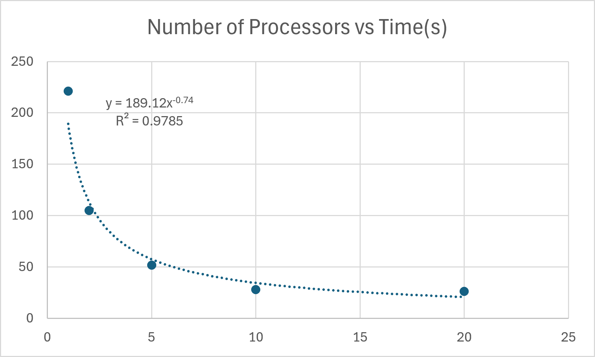

# Lab11_Multiprocessing_Julian_Bolan
 
- Brief: This README.md is for a program creates mandelbrot images that will be stitched together into a movie using a number processes to attempt to speed up / increase the efficency of the image generation code.

 
How to Compile:

 1. make clean
 2. make
 3. ./mandel_fork
  
 OR
   
 gcc -g -o mandel_fork jpegrw.c mandel_fork.c -ljpeg

 
An image of the graph of processors vs time for the mandel_fork.c program has been provided below.

 
Results:
    The graph show that as the number of processes increases, the speedup sees improvements in time reduction of running the program.  However, it is important to note that while the graph shows up to a count of 20 virtual processes running on 14 real processors, the time still is slightly less.  If the number of processes increased past this point, we might start to see a negative impact on the time compared to less processes. Another importatnt item to note is the graph shows diminishing returns, can be noted lucidly at and past the 5 processor count for this implementation of a mandelbrot movie program.